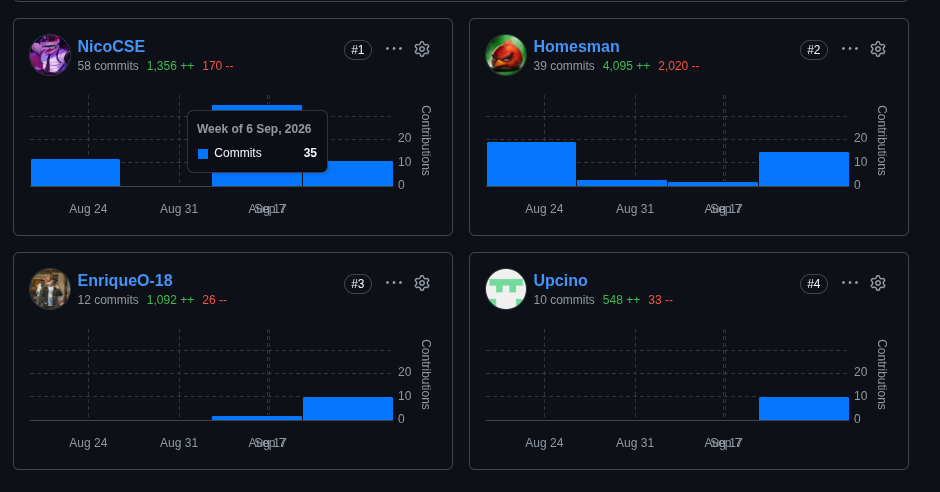
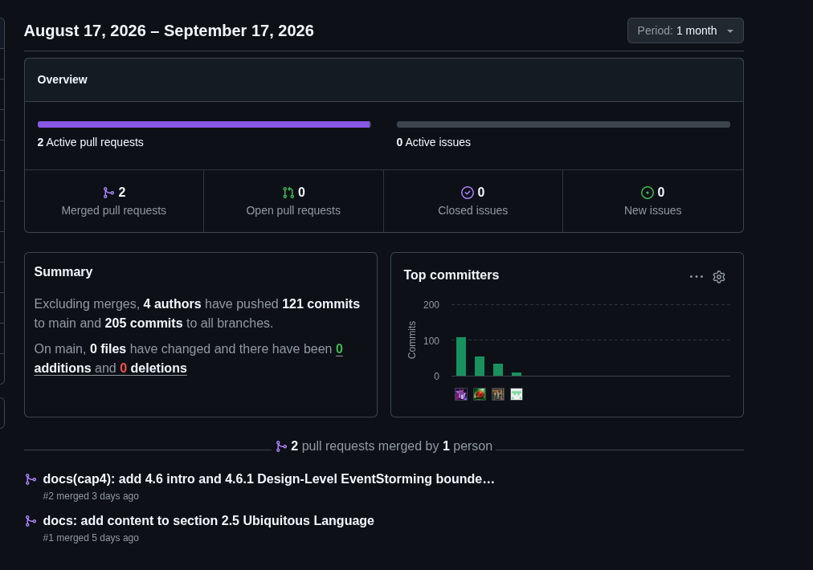
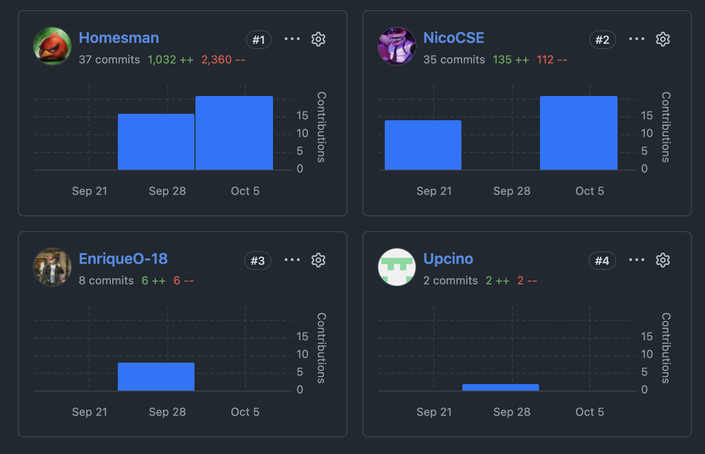
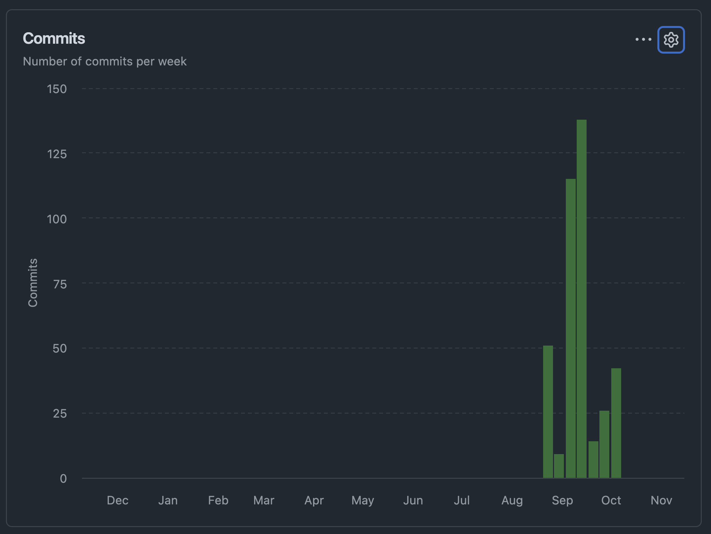
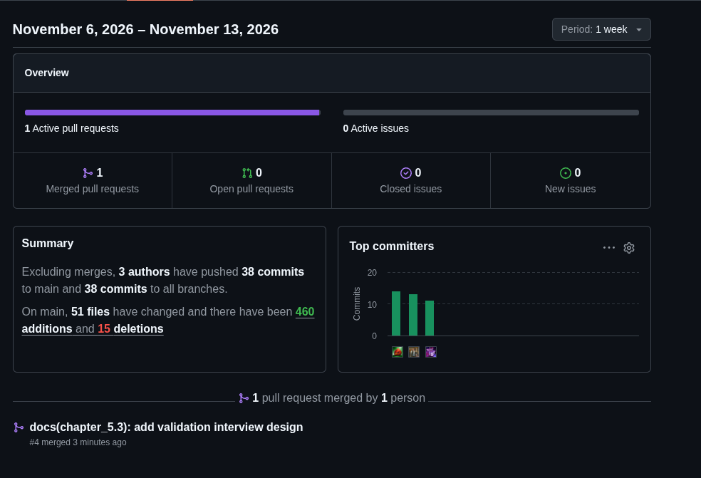
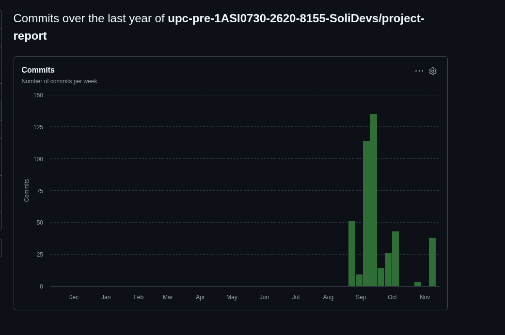

# Project Report Collaboration Insights

El siguiente enlace lleva al URL del repositorio que se encuentra disponible en la organización del equipo: https://github.com/upc-pre-1ASI0730-2620-8155-SoliDevs/project-report

A continuación, se explicará a detalle el desarrollo de actividades para la elaboración del informe, acompañado de capturas de los analíticos de colaboración y los commits hechos en GitHub.

## Avance 1 (AV1)

---

Para la entrega del avance 1, se procede a mostrar el análisis de colaboración, el cual representa el número de contribuciones realizadas en el repositorio del informe por cada integrante del equipo.

La siguiente imagen representa el número de commits por semana realizados en el repositorio a lo largo del periodo comprendido entre agosto y septiembre, evidenciando la concentración del trabajo durante las semanas de desarrollo del primer avance.

## Trabajo Parcial (TB1) 

---

Para la entrega del trabajo parcial, se procede a mostrar el analisis de colaboracion el cual representa el número de contribuciones realizadas en el repositorio del informe por cada integrante del equipo.

La siguiente imagen representa el número de commits por semana realizados en el repositorio a lo largo del periodo comprendido entre agosto y septiembre, evidenciando la concentración del trabajo durante las semanas de desarrollo del trabajo parcial.

## Avance 2 (AV2) 

---

Para la entrega del segundo avance, se procede a mostrar el análisis de colaboración correspondiente a la ventana del sprint 3 (6 al 13 de noviembre), donde el equipo consolidó la implementación de los Web Services .NET, la conexión de la aplicación web con el API real y la redacción de las nuevas secciones del informe (Sprint 3, entrevistas de validación y videos del proyecto). En esta ventana se registraron 38 commits de 3 autores sobre la rama principal, con 51 archivos modificados y 460 líneas añadidas, además de un pull request integrado con el diseño de las entrevistas de validación.

La siguiente imagen representa el número de commits por semana realizados en el repositorio a lo largo del ciclo, evidenciando los tres picos de trabajo del equipo: el AV1 y el TB1 en setiembre y octubre, y el sprint 3 del AV2 en noviembre.

